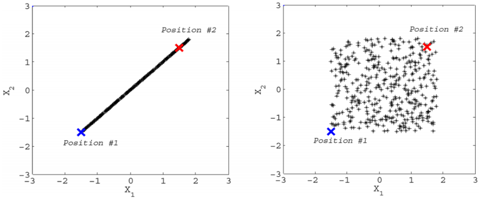
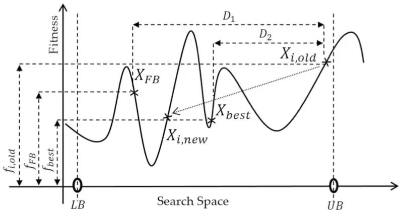
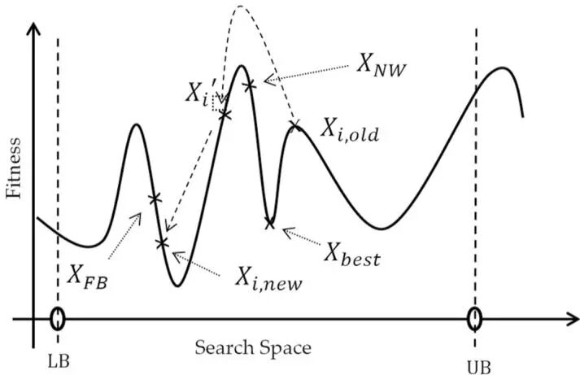
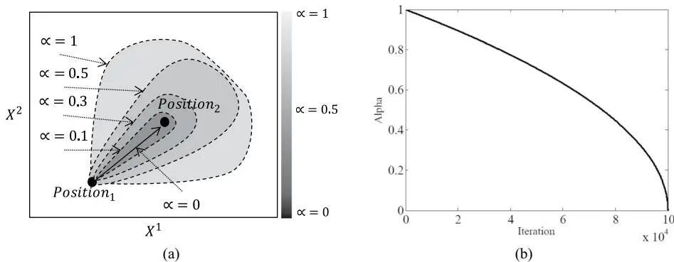
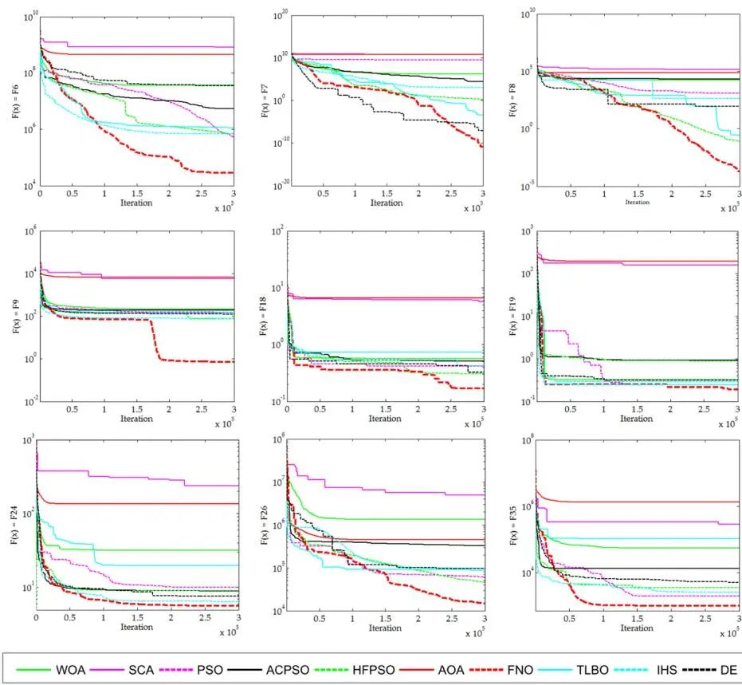
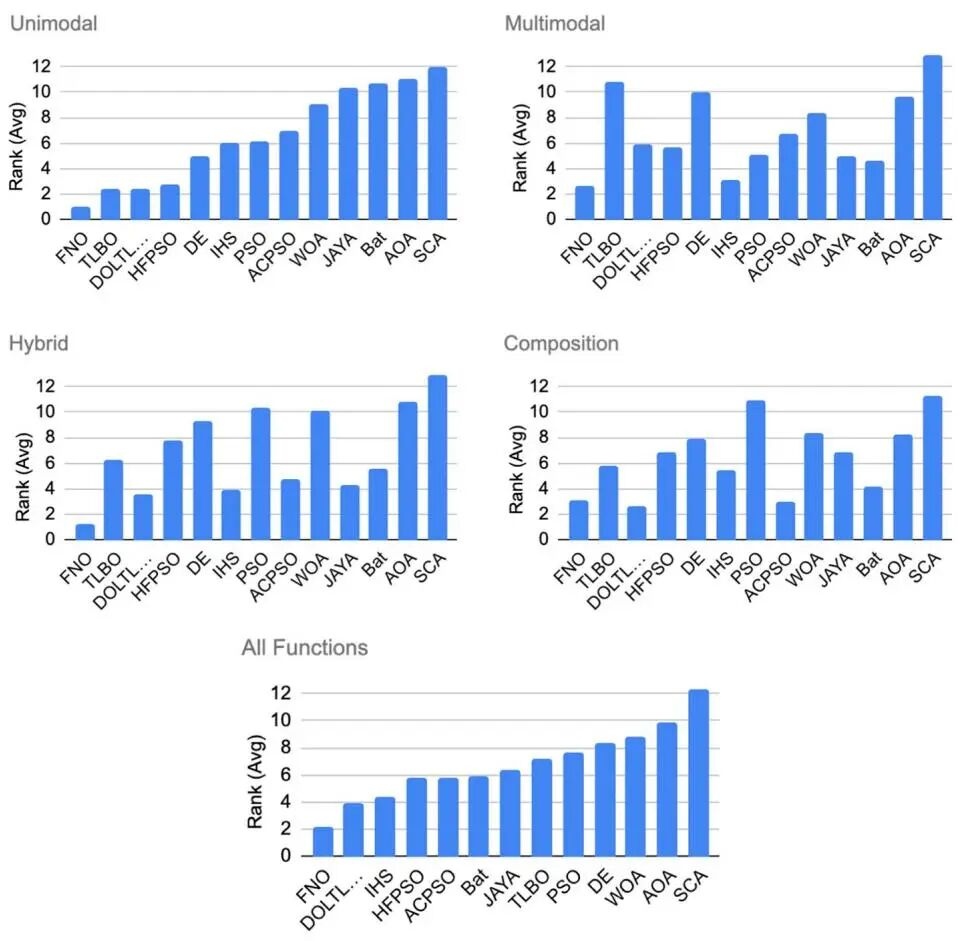
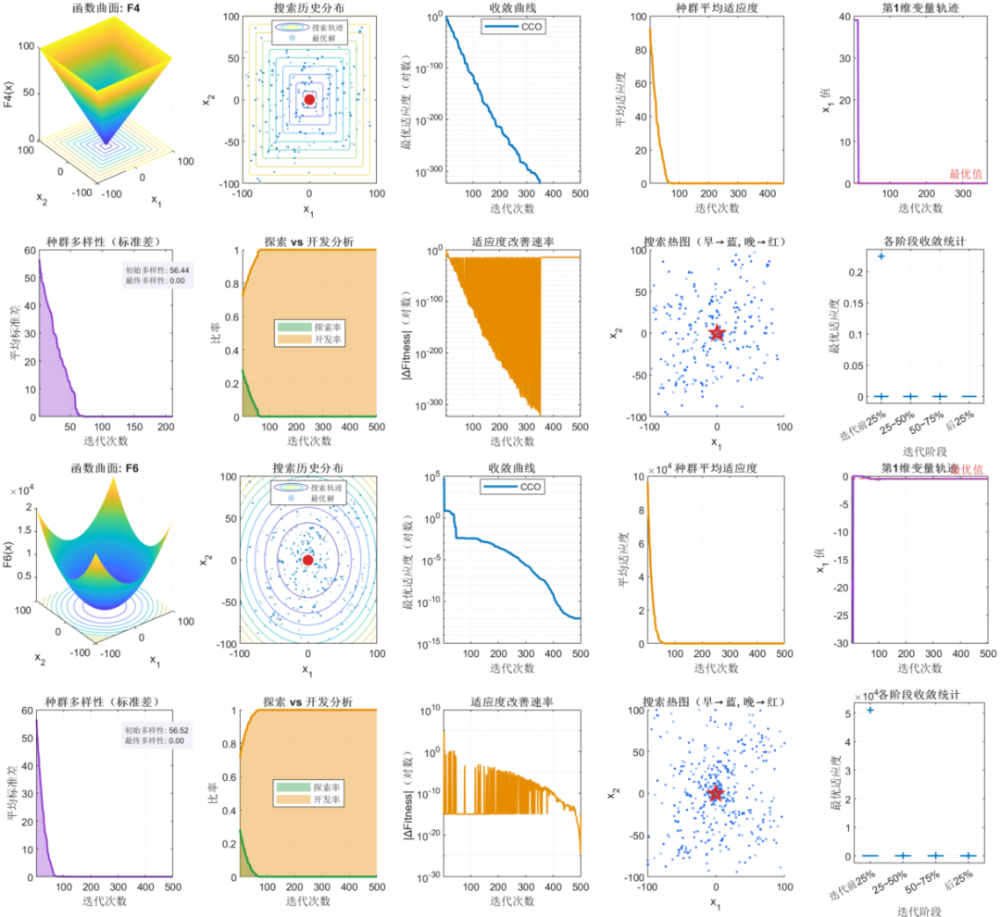

# 2026 Top optimization in Area 1, FNO optimization + search distribution chart, population diversity, exploration and development analysis

Run on platforms: MATLAB R2023a and above, no additional toolboxes required, one-click operation.
Literature interpretation
References: Farthest Better or Nearest Worse Optimizer: A Novel Metaheuristic Algorithm, Artificial Intelligence Review, 2026, DOI: 10.1007/s10462-025-11443-z (First-Class Top, IF=13.9)
In January 2026, Taheri et al. formally published a novel optimizer in Artificial Intelligence Review (first-class top, IF=13.9), the Farthest Better/Nearest Worse Optimizer (FNO). The core logic consists of only two rules: finding the individual farthest away but better than you (Farthest Better, FB), and finding the individual closest but worse than you (Nearest Worse, NW). This approach is very clever: one pulls you farther away while another pushes you to avoid it. With these two rules and a dynamic focus mechanism, FNO comprehensively outperforms 12 mainstream algorithms across 45 benchmark functions and 5 engineering design problems.
The paper on this algorithm was just published in January 2026, with zero improvements on the FNO algorithm currently available! This article provides a complete FNO analysis program that can generate 10 high-quality analysis charts in one run, covering search behavior, population dynamics, exploration-exploitation balance across all dimensions. The charts can be directly embedded into the method comparison section of SCI papers, significantly reducing the barrier for visualizing algorithm performance, making it easy to support Chinese core journals, EI, and even SCI papers!
Why is it worth paying attention to? Existing metaheuristic algorithms generally rely on some metaphors—whale bubble nets, wolf pack hunting levels... Metaphors bring hyperparameters, and hyperparameters bring tuning burden. FNO has no biological or physical background, driven by the distance and fitness within the population for search, with fewer parameters and clear principles, making theoretical analysis and improvement research easier to engage in.
Core Mechanisms:
① Farthest Better (FB) selection - exploration-driven: For each individual, among all individuals with higher fitness than itself, select the one with the farthest Euclidean distance as the guiding target: 
Jump towards "farther better positions," naturally achieving global exploration at a large step size, avoiding premature convergence to local extremities.
② Nearest Worse (NW) selection - leap-avoidance: Among all individuals with lower fitness than itself, find the one with the closest Euclidean distance:
By skipping over inferior solutions around rather than just moving in the opposite direction, the algorithm can quickly avoid many local extremities in complex multi-peak terrains.
③ Dynamic Focus Strategy (DFS) - adaptive contraction: Control parameters follow automatic decay with iterations
Position update logic (two-stage algorithm): Execute NW leap-avoidance with probability, and FB far-exploration + DFS focus with probability. The entire process has a time complexity of (distance matrix computation dominates).
Experimental Performance:
Compared with 12 algorithms (TLBO, JAYA, WOA, SCA, PSO, DE, AOA, Bat, etc.) on 45 benchmark functions (CEC2005, CEC2014, CEC2019), FNO's overall average rank is 2.17, ranking first, and under Wilcoxon test, significantly outperforming all 12 competitors (. Single peak function ranking #1, multi-peak function ranking #2.69 (optimal), mixed function ranking #1.29).
5 classic engineering problems (pressure vessel design, welded beam design, spring design, cantilever design, three-bar truss), FNO achieves optimal or equal results in all these issues.
This article improves work - why is only convergence curve not enough?
The experience with SCI (Scientific Citation Index) knows that reviewers only say "This does not demonstrate any difference in the search mechanism of the algorithm" when they see a convergence curve. What truly convinces reviewers is multi-dimensional qualitative analysis—where has the algorithm moved within the search space? When did population diversity decrease? Was the transition between exploration and development smooth or abrupt? Answering these questions cannot be done solely by benchmark numbers. This paper adds:
Follow the editor to receive irregularly high-quality innovative learning materials, articles, and code snippets, boosting your research endeavors!

## Images

<!-- PAYMENT_BLOCK -->

## Get this dataset

- Payment link (Stripe): [Buy now](https://buy.stripe.com/3cs8yP7sY87d0vu9AB)
- Payment QR code: 

<!-- /PAYMENT_BLOCK -->
